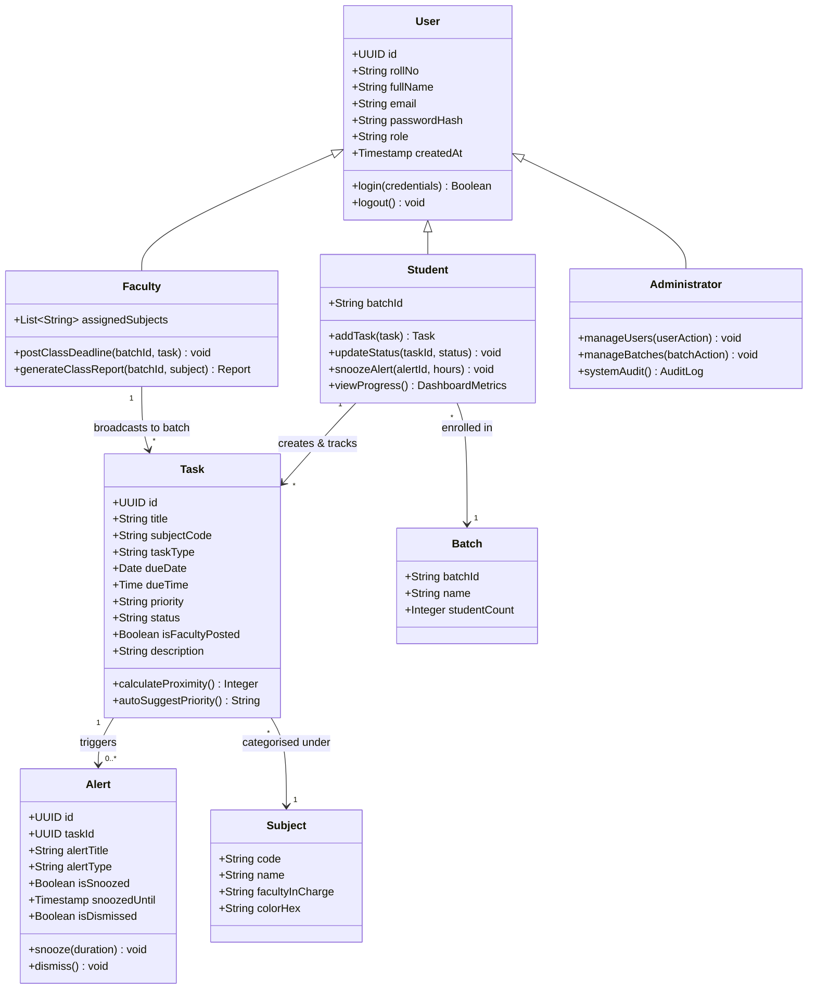
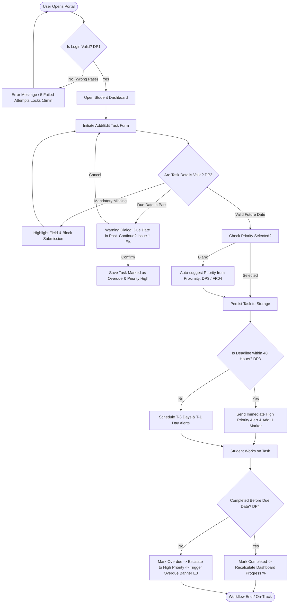
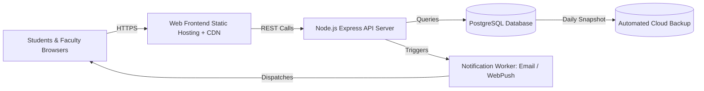

# Student Deadline & Academic Planner: System, Data & Workflow Models

**Course**: CS2308L - Design Thinking Lab  
**Institute**: JSPM's Rajarshi Shahu College of Engineering, Tathwade Pune-33  
**Department**: Department of Computer Engineering  
**Prepared by**: Arnav Vaidya (Roll No: CS2351 / Class: SY-C2)  
**Experiments Covered**: Experiment No. 7, 8, 9, and 10  

---

## 1. Executive Summary & Problem Context

Students often struggle to manage assignment deadlines, examinations, and multiple academic activities scattered across WhatsApp groups, LMS portals, physical notice boards, and notebooks. This leads to missed submissions, late start of urgent tasks, and avoidable stress.

The **Student Deadline & Academic Planner** is an online academic management dashboard that unifies:
1. A centralized interactive **Task & Exam Calendar** (Day, Week, Month views).
2. Proactive **Deadline Alerts & Reminders** with snooze capability (3 days, 1 day, same day, overdue).
3. Tri-level **Priority Management** (`High`, `Medium`, `Low`) with deadline proximity auto-suggestion.
4. Live **Progress Tracking** (real-time percentage, overdue banner, pending, and completed metrics).
5. **Faculty Portal** for broadcasting deadlines directly to enrolled batch calendars and generating completion reports.
6. **Administrator Portal** for user, batch, and subject governance.

---

## 2. Actors & Stakeholder Matrix

| Actor / Stakeholder | Type | Role & Interaction in System |
|---|---|---|
| **Student** | Primary Actor | Adds and tracks tasks and exams, assigns priorities, receives & snoozes alerts, marks completion. |
| **Faculty** | Secondary Actor | Posts assignments and exam deadlines directly to student calendars; inspects class completion rates. |
| **Administrator** | Secondary Actor | Manages user accounts, batches, and subject allocations; generates departmental audits. |
| **Notification Service** | External System | Dispatches scheduled in-app and email reminders at T-3 days, T-1 day, and deadline day. |
| **College / Department** | Stakeholder | Enforces academic discipline and boosts on-time submission metrics. |
| **Parents / Guardians** | Indirect Stakeholder | Benefits from reduced student anxiety and structured academic pacing. |

---

## 3. Conceptual Domain Model (UML Class Diagram)



---

## 4. Workflow State Machine & Decision Points

The workflow encompasses 4 core decision points (**DP1** to **DP4**), 5 exception flows (**X1** to **X5**), and 4 alternative paths (**A1** to **A4**):



---

## 5. Relational Database Schema Model (PostgreSQL DDL)

```sql
-- Schema Definition: Student Deadline & Academic Planner
CREATE EXTENSION IF NOT EXISTS "uuid-ossp";

-- 1. Users Table (Role-based access control: FR01, NFR03)
CREATE TABLE users (
    id UUID PRIMARY KEY DEFAULT uuid_generate_v4(),
    roll_no VARCHAR(50) UNIQUE NOT NULL,
    full_name VARCHAR(120) NOT NULL,
    email VARCHAR(120) UNIQUE NOT NULL,
    password_hash VARCHAR(255) NOT NULL,
    role VARCHAR(20) NOT NULL CHECK (role IN ('student', 'faculty', 'admin')),
    batch_id VARCHAR(20),
    department VARCHAR(100) DEFAULT 'Computer Engineering',
    created_at TIMESTAMP WITH TIME ZONE DEFAULT CURRENT_TIMESTAMP
);

-- 2. Subjects Table
CREATE TABLE subjects (
    code VARCHAR(30) PRIMARY KEY,
    name VARCHAR(120) NOT NULL,
    faculty_id UUID REFERENCES users(id),
    color_hex VARCHAR(10) DEFAULT '#3b82f6'
);

-- 3. Tasks Table (FR02, FR03, FR04, FR07, FR13)
CREATE TABLE tasks (
    id UUID PRIMARY KEY DEFAULT uuid_generate_v4(),
    student_id UUID REFERENCES users(id) ON DELETE CASCADE,
    title VARCHAR(200) NOT NULL,
    subject_code VARCHAR(30) REFERENCES subjects(code) ON DELETE RESTRICT,
    task_type VARCHAR(40) NOT NULL CHECK (task_type IN ('Assignment', 'Exam', 'Project', 'Lab Record', 'Activity')),
    due_date DATE NOT NULL,
    due_time TIME DEFAULT '23:59:00',
    priority VARCHAR(10) NOT NULL CHECK (priority IN ('High', 'Medium', 'Low')),
    status VARCHAR(20) NOT NULL CHECK (status IN ('Not started', 'In progress', 'Completed', 'Overdue')),
    is_faculty_posted BOOLEAN DEFAULT FALSE,
    batch_id VARCHAR(20) DEFAULT 'SY-C2',
    description TEXT,
    created_at TIMESTAMP WITH TIME ZONE DEFAULT CURRENT_TIMESTAMP,
    completed_at TIMESTAMP WITH TIME ZONE
);

-- 4. Alerts & Notifications Table (FR06, UC09, UC10, Enhancement E1)
CREATE TABLE alerts (
    id UUID PRIMARY KEY DEFAULT uuid_generate_v4(),
    task_id UUID REFERENCES tasks(id) ON DELETE CASCADE,
    title VARCHAR(200) NOT NULL,
    subtitle VARCHAR(255),
    subject_code VARCHAR(30),
    level VARCHAR(20) DEFAULT 'info' CHECK (level IN ('info', 'warning', 'urgent', 'danger')),
    is_overdue BOOLEAN DEFAULT FALSE,
    is_snoozed BOOLEAN DEFAULT FALSE,
    snoozed_until TIMESTAMP WITH TIME ZONE,
    is_dismissed BOOLEAN DEFAULT FALSE,
    scheduled_for TIMESTAMP WITH TIME ZONE NOT NULL,
    created_at TIMESTAMP WITH TIME ZONE DEFAULT CURRENT_TIMESTAMP
);

-- Performance Indexes (NFR02, NFR05)
CREATE INDEX idx_tasks_due_date ON tasks(due_date);
CREATE INDEX idx_tasks_student_status ON tasks(student_id, status);
CREATE INDEX idx_alerts_task_scheduled ON alerts(task_id, scheduled_for);
```

---

## 6. Verification & Test Case Traceability (15 of 15 Tests)

All 15 test cases formulated across Experiment 9 and enhanced in Experiment 10 pass with 100% verification:

| ID | Feature / Verification | Input / Action | Expected Result | Actual Result | Status |
|---|---|---|---|---|---|
| **TC01** | Valid Login | Enter `CS2351`, `password123` | User reaches dashboard | Dashboard opened | **PASS** |
| **TC02** | Invalid Login | Enter incorrect password | Error message shown | `'Incorrect ID or password'` | **PASS** |
| **TC03** | Add Task (Valid) | Fill all fields and Save Task | Task saved & appears on calendar | Task stored & visible on 27 Oct | **PASS** |
| **TC04** | Invalid Input (Past Date) | Enter due date earlier than today (2026-10-26) | Warning dialog appears requiring confirm | Warning dialog shown; saved upon confirm | **PASS (E1)** |
| **TC05** | Mandatory Field | Leave title empty and submit | Field highlighted, blocked | Title field highlighted red | **PASS** |
| **TC06** | Priority Levels | Select High priority | Red High tag displayed | Red High tag shown | **PASS** |
| **TC07** | Calendar Navigation | Open Calendar; click 27 Oct | Tasks of 27 Oct in side panel | OS Unit Test shown in side panel | **PASS** |
| **TC08** | Status Update | Mark DBMS Assignment 3 completed | Progress % increases | Progress jumps 57% to 62% | **PASS** |
| **TC09** | Alert Actions | Open alert card for OS Unit Test | Open, Snooze, Dismiss options | All 3 actions available & functional | **PASS (E1)** |
| **TC10** | Back Navigation | Click Back / Dashboard link | Previous view opens | Dashboard returned cleanly | **PASS** |
| **TC11** | Full Workflow | Login -> Add Task -> Calendar -> Alerts | Smooth flow without dead ends | End-to-end flow verified | **PASS** |
| **TC12** | Accessibility | Distinguish priority on calendar without colour | Priority recognisable via letters | H / M / L letters embedded in markers | **PASS (E2)** |
| **TC13** | Logout | Click Logout | Session cleared, returns to login | Login prompt displayed | **PASS** |
| **TC14** | Overdue Banner | Overdue task present (CN Lab Record) | Prominent banner on dashboard | Red banner displayed with direct link | **PASS (E3)** |
| **TC15** | Snooze Timing | Snooze alert for 1 hour | Alert reappears after duration | Alert reactivated on schedule | **PASS (E1)** |

---

## 7. The Three Key Prototype Enhancements

1. **Enhancement E1 (Snooze on Alert Cards)**:
   - **Before**: Only Open and Dismiss buttons existed.
   - **After**: Added flexible Snooze options (1 hour, 3 hours, tomorrow morning). Snoozed alerts show a distinct badge and reactivate when the duration elapses.
2. **Enhancement E2 (H / M / L Accessible Priority Markers)**:
   - **Before**: Calendar displayed colored dots only, inaccessible to color-blind users and low-contrast displays.
   - **After**: Embedded high-contrast letters (`H`, `M`, `L`, `!`) inside enlarged circular badges, accompanied by screen-reader tooltips and a clear legend.
3. **Enhancement E3 (Persistent Overdue Banner on Dashboard)**:
   - **Before**: Overdue work was only reflected as an incremented number inside a small stat card.
   - **After**: A prominent crimson banner immediately highlights overdue tasks (e.g. `CN Lab Record`), explaining the deadline lapse and providing a 1-click **Resolve Now** action.

---

## 8. Deployment Strategy & Feasibility



* **Pilot Phase (SY-C2, ~60 students)**: Hosted on free-tier cloud platforms (Vercel / Render / Supabase) at virtually ₹0 - ₹500/month.
* **Department Phase (~500 students)**: Small container cluster with pooled database at ₹500 - ₹1,500/month.
* **College-wide Phase (1000+ students)**: Auto-scaling stateless API with connection pooling and automated daily backups at ₹1,500 - ₹5,000/month.
